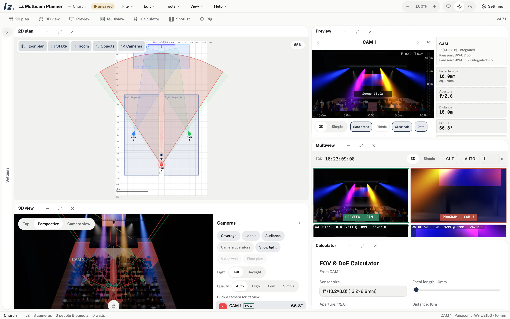
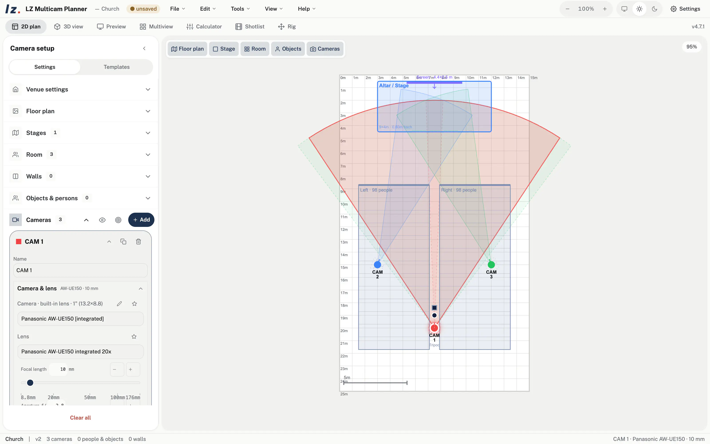
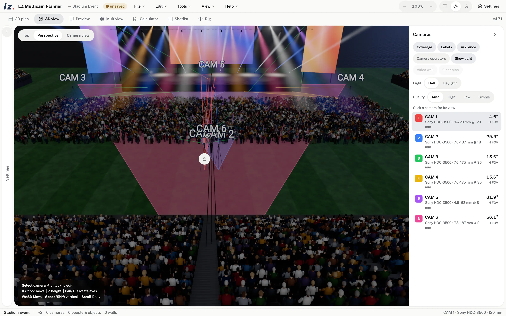
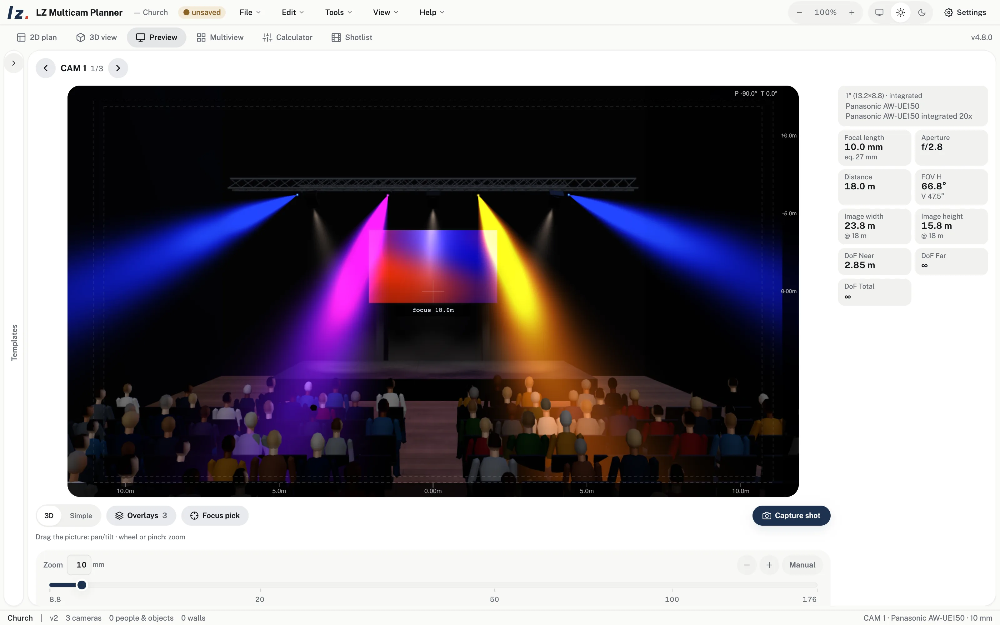
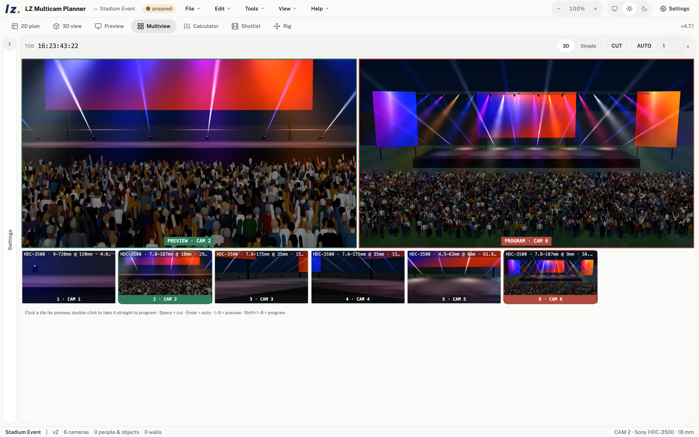
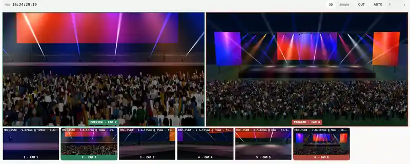

# LZ Multicam Planner

**Draw your cameras into the room and see at once whether the lenses fit.**

[](https://larszu.github.io/lz-multicam-planner/)
[](https://github.com/larszu/lz-multicam-planner/releases/latest)
[](https://github.com/larszu/lz-multicam-planner/releases/latest)
[](https://github.com/larszu/lz-multicam-planner/releases/latest)
[](docs/FEATURES.md)

<picture>
  <source media="(prefers-color-scheme: dark)" srcset="docs/img/hero-dark.webp">
  
</picture>

Place cameras on the floor plan, pick body and lens from the catalogue, and look
through every camera before a single cable is laid. In the browser or as a
desktop app for macOS and Windows. Free to use.

## Why

Every camera position comes down to one question: does this lens give the shot
from here? The planner answers it with the real sensor and focal length — in
the plan, in 3D and as a picture. No CAD, no layers: a project starts with a
template or a floor plan, and the first camera is one click away.

## What it does

<table>
<tr>
<td width="50%" valign="top">
<picture>
  <source media="(prefers-color-scheme: dark)" srcset="docs/img/plan-2d-dark.webp">
  
</picture>
<b>Floor plan with real field of view.</b> Drag a camera into place; its cone
shows the frame width at the focus distance, the depth-of-field band shows what
is sharp. Import an image or PDF floor plan and calibrate it with two points.
</td>
<td width="50%" valign="top">
<picture>
  <source media="(prefers-color-scheme: dark)" srcset="docs/img/view-3d-dark.webp">
  
</picture>
<b>Photoreal 3D, through every lens.</b> Stage light in haze, LED walls,
thousands of people in the audience. Click a camera in the list to look through
it — framed to the sensor, following pan, tilt and zoom.
</td>
</tr>
<tr>
<td width="50%" valign="top">
<picture>
  <source media="(prefers-color-scheme: dark)" srcset="docs/img/preview-dark.webp">
  
</picture>
<b>Camera view.</b> The camera's picture with its focal length, aperture
and focus, plus safe areas, thirds, frame masks (9:16, 4:5, 1:1, 2.39) and a
data readout — *3D view → Camera view*. The viewfinder label under the picture
names camera, format, aperture, crop, lens and focal length; ‹ › steps through
the lenses that fit and the picture follows; save it as a PNG for the client.
Fold out the camera control underneath and save the shot to a shotlist.
</td>
<td width="50%" valign="top">
<picture>
  <source media="(prefers-color-scheme: dark)" srcset="docs/img/multiview-dark.webp">
  
</picture>
<b>Multiview like a vision mixer.</b> Every camera as a live tile, large
Preview and Program, CUT (Space) and AUTO (Enter). Test pattern per tile,
lower tile resolution for many cameras, the whole wall as a PNG with frame
rate. The director sees the show before the first rehearsal.
</td>
</tr>
</table>

<picture>
  <source media="(prefers-color-scheme: dark)" srcset="docs/img/multiview-switch-dark.webp">
  
</picture>

**Also inside**

- **Camera and lens catalogue:** 377 cameras from 36 brands, 835 lenses from 37 brands, 49 camera rigs — almost all with a link to the manufacturer's datasheet. Adapters, extenders and your own devices included.
- **Floor plan to walls:** a vector PDF or DXF gives walls, doors, windows, stages and scale without AI; scans go to Claude, ChatGPT, Gemini, Mistral or Grok with your own API key. The detected walls lie on the plan they came from, and *Move plan by dragging* lines the image up with them afterwards.
- **One room out of a building plan:** *Floor plan → New sub-plan from an area…* crops a room into a new project with its own cameras; walls, stages and audience inside it come along at the same scale. Keep the building plan as its own file and make one sub-plan per room.
- **One picture everywhere:** 3D view, camera view and multiview render the same scene with the same light and tone mapping; the angle of view comes from sensor, focal length, extender and squeeze, shown 16:9 whatever the window shape.
- **Depth of field from the camera data:** focus distance, aperture, focal length and sensor — the sharp zone in the picture matches the DoF numbers beside it. In 3D (*Depth of field* in the camera list) it is a body between near and far limit with the focus plane and hyperfocal distance marked; the same switch draws it as a band in the 2D plan.
- **One colour and number per camera:** list, 2D plan, the number marker over each camera in 3D, multiview tile, viewfinder label and camera card all carry the same colour and number.
- **Show light you can set:** brightness, colour mood, haze, number and kind of fixtures — generated from your stages, stored in the project.
- **Daylight and real camera bodies in 3D:** sun, sky and weather from date, time and place; each camera drawn as its body, lens and rig.
- **Camera sheet:** height and rig per camera (starting height and range per rig), focal length slider within the lens, a target to aim at (stage centre, person, object or point) that the camera can keep following, and the values that answer the lens question — distance to the target, frame width and height there, shot size. *View from this camera*, *Reset*, and *Copy positions* as text, Markdown or CSV — pasted back, they move or add cameras.
- **Select, copy, paste:** click to select, Shift/Ctrl/⌘-click to add, Shift-drag a frame in the 2D plan; drag one to move them all, `Del` deletes, `Ctrl/⌘+C` / `Ctrl/⌘+V` copies with new ids, 1 m offset per paste — each one undo step. A person dropped on or next to a free chair sits down on it, at the chair's seat height and facing its way, and moves with it.
- **Audience and room:** seated and standing areas, dragged as rectangles on the 2D plan and facing the main stage — with a floor plan or walls, people appear only in these areas; an empty room without either fills its free floor on its own. Video walls, ceiling height, floor and wall materials. Walls are solid in 3D; *Draw glass front* draws see-through walls that block no sightline, and every wall takes doors and windows (windows glazed). Walls take a standard height for the whole room; any wall can have its own, an empty field uses the standard.
- **Shotlist and rig:** capture shots, set transitions, play the sequence, export a storyboard — shotlists are saved in the project file; record and replay camera moves within the rig's real limits.
- **Templates:** football stadium, stadium event, small and large concert, church, conference — or save your own.
- **Live from a control panel:** with *Settings → Bridge & mixer* switched on, the planner connects to [LZ Camera Bridge](https://github.com/larszu/lz-camera-bridge) (default `ws://localhost:9700`, reconnects on its own, status in the status bar). Pan, tilt and zoom the bridge reports — for example from a Broadcast Pix joystick — turn the planned camera in 2D and 3D; the camera chosen on the panel gets a dashed ring in 2D and a green tally in 3D. Each planned camera follows the bridge camera with the number in its name (*CAM 2* → 2); a different number goes in the camera's *Bridge camera* field. The plan stays as it was until you click *Apply* on the camera marked *Live*.
- **Multiview from a mixer:** *Settings → Bridge & mixer → Multiview follows a mixer* shows programme and preview of an ATEM directly — no bridge needed, desktop app only, since a browser cannot speak the ATEM's UDP protocol — or of any mixer the bridge drives — a real ATEM as well as its *virtual mixer*, switched from a control panel. *Cameras on mixer inputs* places each camera on an input, with the input names the mixer reports; *Assign by name* matches “CAM 1” to “Cam1”. Inputs without a camera (bars, clips) show their name in the bus window. A real mixer is only shown unless *Switch this mixer from the multiview* is on; the virtual mixer takes the planner's cuts and camera names back, so tally and the panel's buttons match. AUTO dissolves here too. The bridge's switcher page opens the planner ready for this (`?bridge=ws://…:9700&mixer=1`). The browser build allows the bridge at `ws://localhost:9700`.
- **Formats and frame masks:** a body's recording formats (sensor modes) show their size in mm and, where the data sheet gives it, in pixels; *Frame mask* puts 2.39, 1.85, 4:3, 1:1, 4:5 or 9:16 on the picture and gives the masked angle of view. Optional — without a mask the full format counts.
- **B4 lenses on large sensors:** *Optical converter* fits an IB/E HDx converter between a B4 zoom and a PL/EF/E/FZ/MFT body: magnification, light loss and image circle from the manufacturer's data sheet go into angle of view, aperture and the coverage check. Typing a broadcast model code (`HA22x7.8BERM`) into a custom lens fills its focal range.
- **Control route per camera:** under *Picture state*, after the protocol, say how the commands get there — direct, through a robotic head, or through a network-serial bridge with interface, line settings (baud, data bits, parity, stop bits), pinout, bridge mode and port. VISCA has its values from Sony's command list one click away; the card says when protocol and route do not fit. Addresses stay out of the plan.
- **Assistant connection (MCP), desktop app:** *Settings → Assistant (MCP)* lets an AI assistant on the same computer work in the plan step by step — `scene_outline`, `get_node`, `place_camera`, `aim_at` (also `look_at`), `frame_shot`, `set_lens`, `move_camera`, `render_preview`, `render_top_view`, `undo`/`redo`. Off by default, only on `127.0.0.1:4191` with a token, changing the plan is a second switch, every change is one undo step, no access data is offered.
- **Hands over to the Cable Planner:** cameras, lenses and positions travel in the `.avplan` exchange file.

## Quick start

1. [Open the planner in the browser](https://larszu.github.io/lz-multicam-planner/) or install the [desktop app](https://github.com/larszu/lz-multicam-planner/releases/latest).
2. Start from a template (sidebar → *Templates*) or upload your floor plan.
3. *Add* a camera, choose body and lens, drag it into position.
4. Check the shot in *3D view → Camera view*; switch between cameras in *Multiview*. In 3D the Preview camera is green and the Program camera red; the *Tally* switch in the 3D camera list turns that off.
5. Save the project (`.mcplan`, `Ctrl/⌘+S`) or export a PNG sheet with plan, 3D view, camera view and data. *Save* writes back to the file you opened or saved last and only asks the first time; *Save as…* (`Ctrl/⌘+Shift+S`) always asks for a name and location. The desktop app, Chrome and Edge save in place; other browsers download a new copy each time. Every save counts up the project's revision; the status bar and the PNG sheet show it with the time of the last save (*Revision 3 · saved 04.11.2026 14:32*), next to the app version. The PNG sheet always shows the 3D view from the start position and the whole floor plan, whatever you are zoomed into — the views on screen stay where they are.

### Windows: dedicated graphics card

The app asks for the high-performance GPU on its own. On laptops with Intel and NVIDIA/AMD graphics, Windows can still hand it the integrated one, and the 3D view stutters.

- **Use the installer** (`LZ Multicam Planner Setup x.y.z.exe`). It installs to a fixed folder that stays the same across updates, so a Windows graphics setting for it lasts. The portable `.exe` unpacks itself into `%TEMP%\lz-multicam-planner` and runs from there; a setting on the downloaded file does not reach that copy.
- Windows Settings → System → Display → Graphics → add the app → *High performance*, then restart the app. Which file to add is shown in the app under *Settings → General → Graphics* (*Program file*).
- The same place shows the WebGL renderer and the graphics cards Chromium sees, with the one in use marked. If it still says Intel UHD/Iris while an NVIDIA card is listed, the app says so there.

## Kurz auf Deutsch

LZ Multicam Planner zeichnet Kameras in den Raum und zeigt sofort, ob die
Optiken passen: Grundriss mit echtem Bildwinkel, fotorealistisches 3D mit Blick
durch jede Kamera (*3D-Ansicht → Kamerablick*) und Multiview mit Preview,
Program, CUT und AUTO. In 3D ist die Preview-Kamera grün und die
Program-Kamera rot; der Schalter *Tally* in der Kameraliste blendet das aus. Läuft im Browser und als Desktop-App für macOS und Windows,
kostenlos nutzbar.

Im Kamerablatt: Höhe und Montage je Kamera, Brennweiten-Schieber in den
Grenzen des Objektivs, ein Ziel (Bühnenmitte, Person, Objekt oder Punkt), auf
das die Kamera sich ausrichtet, und darunter Entfernung, Bildbreite und
Einstellungsgröße am Ziel. *Aus dieser Kamera sehen*, *Zurücksetzen* und
*Positionen kopieren* als Text, Markdown oder CSV — eingefügt verschiebt die
Liste Kameras oder legt neue an.

Live vom Pult: *Einstellungen → Bridge & Mischer* verbindet mit LZ Camera
Bridge; Schwenk, Neigung und Zoom der Bridge (etwa vom Joystick) drehen die
geplante Kamera mit derselben Nummer in 2D und 3D. Erst *Übernehmen* schreibt
die Stellung in den Plan. Unter *Multiview folgt einem Bridge-Mischer* kommen
Program und Preview von einem Mischer: ein ATEM auch ohne Bridge direkt aus der
Desktop-App (*ATEM direkt, ohne Bridge*, Adresse eintragen), sonst jeder
Mischer der Bridge. Unter
*Kameras auf Mischer-Eingängen* liegt jede Kamera auf dem Eingang, den man
wählt (mit den Eingangsnamen des Mischers, *Nach Namen zuordnen* hilft). Einen
echten Mischer zeigt der Planer nur, außer *Diesen Mischer aus der Multiview
schalten* ist an; der Mischer ohne Hardware übernimmt Schnitte und
Kameranamen vom Planer.

Optik und Steuerung: *Rahmenmaske* legt 2.39, 1.85, 9:16 … aufs Bild,
*Optischer Konverter* setzt ein B4-Objektiv über einen IB/E-HDx-Konverter an
einen großen Sensor (Werte vom Datenblatt), und unter *Bildzustand* steht je
Kamera der Steuerweg: direkt, über Robotik-Kopf oder über eine
Netzwerk-Seriell-Bridge mit Schnittstelle, Leitungswerten, Belegung, Betriebsart
und Port. *Einstellungen → Assistent (MCP)* lässt einen KI-Assistenten auf
diesem Rechner im Plan arbeiten — aus als Vorgabe, jede Änderung ein
Rückgängig-Schritt.

Windows-Rechner mit zwei Grafikkarten: den Installer statt der portablen
Fassung nehmen und die Programmdatei (angezeigt unter *Einstellungen →
Allgemein → Grafik*) in den Windows-Grafikeinstellungen auf *Hohe Leistung*
stellen.

## Documentation

- [Plan import](docs/plan-import.md) — walls, doors, windows, columns and rooms straight out of a vector PDF or DXF, to scale and without AI; what the AI is still for, and how accurate it is on five real architect's drawings.
- [Feature reference](docs/FEATURES.md) — every function in detail: catalogue, device library, 2D, 3D, preview, multiview, shotlist, rig, project files, design, tech stack, scripts and architecture notes.
- [Releases](https://github.com/larszu/lz-multicam-planner/releases) — installers for macOS and Windows.

### Build from source

```bash
npm install
npm run dev        # http://localhost:4182
npm run desktop    # Electron in dev mode
npm run dist:mac   # DMG + ZIP (on macOS)
npm run dist:linux # AppImage + deb (on Linux, host arch)
npm run dist:win   # installer + portable
```

**Source language:** `en` — German is the first translation. Background in the
[feature reference](docs/FEATURES.md#tech-stack).

## Support

If LZ Multicam Planner saves you time on your next show, you can buy me a coffee:

<a href="https://paypal.me/larszumpe"></a>

Donations are optional — the app stays free to use.

## License

Free to use, source available — not open source. © 2026 Lars Zumpe, all rights
reserved. Using the published builds costs nothing, also commercially;
redistribution and derived works need written permission. See [LICENSE](LICENSE).

---

Made by [Lars Zumpe Medienproduktion](https://larszu.github.io) · Feedback and feature requests welcome in [Issues](https://github.com/larszu/lz-multicam-planner/issues).
