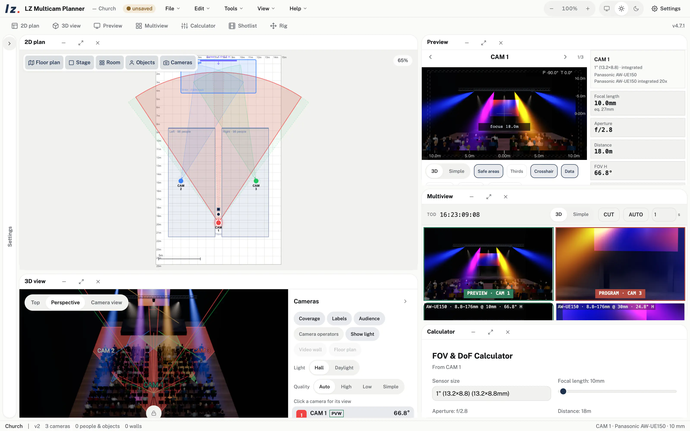
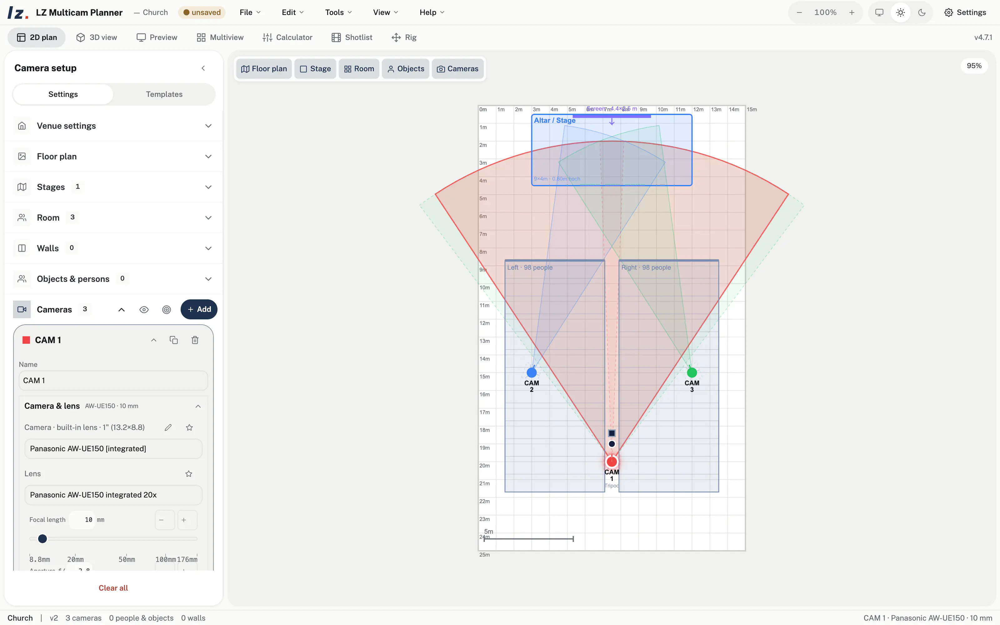
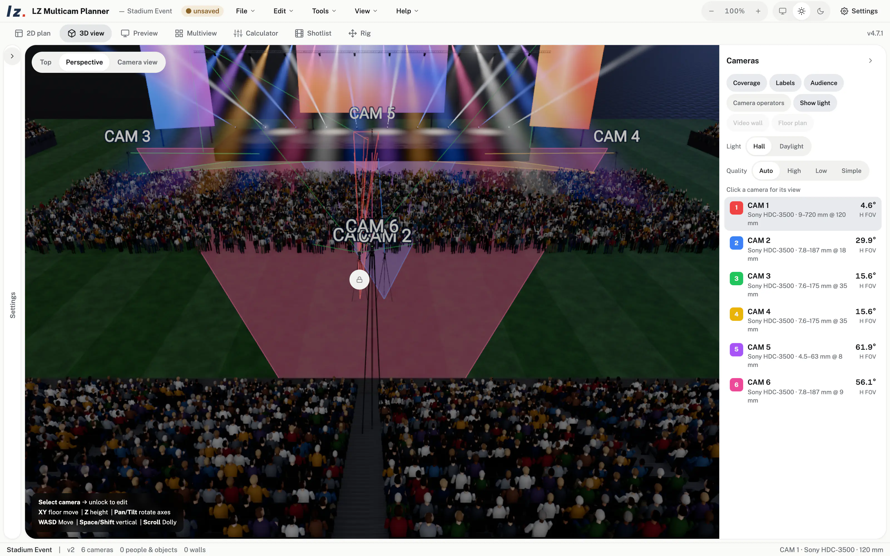
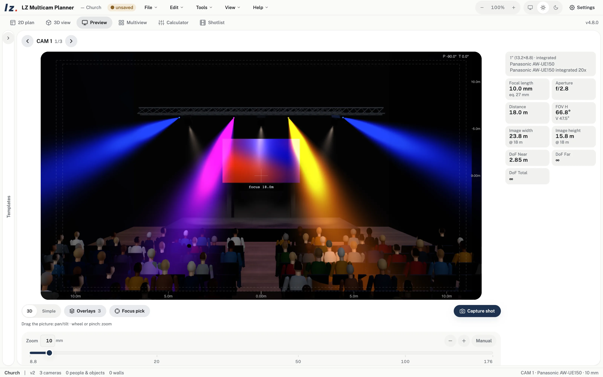
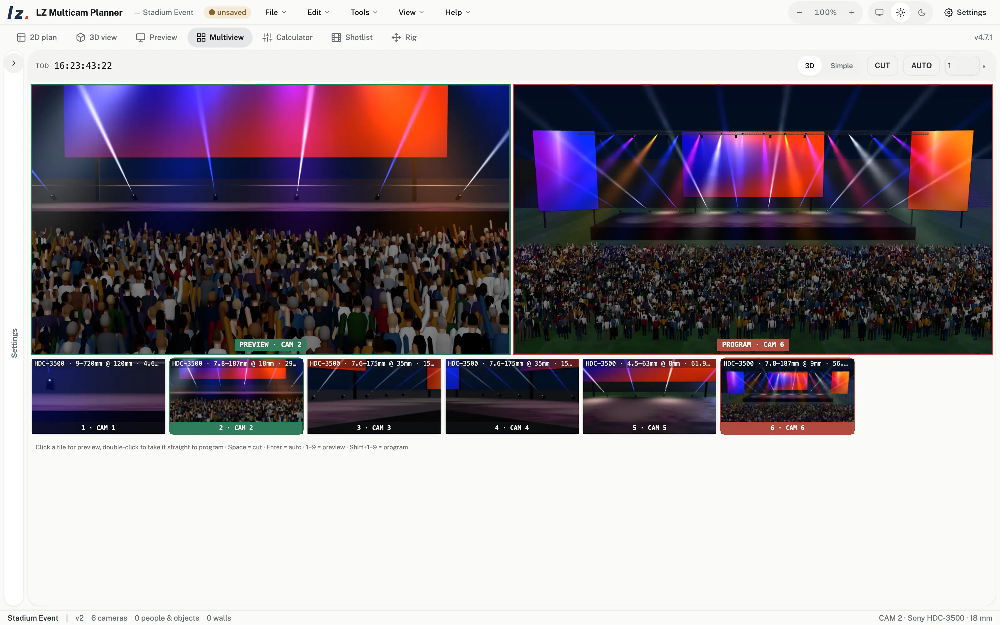
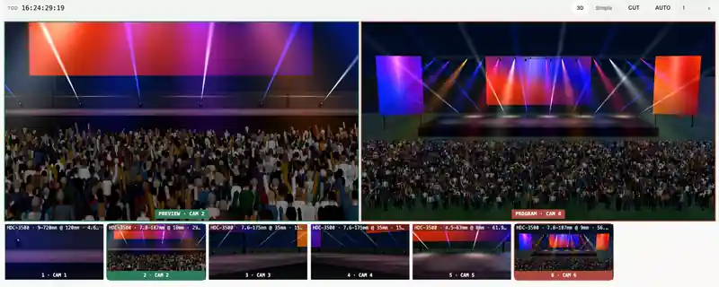

# LZ Multicam Planner

**Draw your cameras into the room and see at once whether the lenses fit.**

[](https://larszu.github.io/lz-multicam-planner/)
[](https://github.com/larszu/lz-multicam-planner/releases/latest)
[](https://github.com/larszu/lz-multicam-planner/releases/latest)
[](docs/FEATURES.md)

<picture>
  <source media="(prefers-color-scheme: dark)" srcset="docs/img/hero-dark.webp">
  
</picture>

Place cameras on the floor plan, pick body and lens from the catalogue, and look
through every camera before a single cable is laid. In the browser or as a
desktop app for macOS and Windows. Free to use.

## Why

Every camera position comes down to one question: does this lens give the shot
from here? The planner answers it with the real sensor and focal length — in
the plan, in 3D and as a picture. No CAD, no layers: a project starts with a
template or a floor plan, and the first camera is one click away.

## What it does

<table>
<tr>
<td width="50%" valign="top">
<picture>
  <source media="(prefers-color-scheme: dark)" srcset="docs/img/plan-2d-dark.webp">
  
</picture>
<b>Floor plan with real field of view.</b> Drag a camera into place; its cone
shows the frame width at the focus distance, the depth-of-field band shows what
is sharp. Import an image or PDF floor plan and calibrate it with two points.
</td>
<td width="50%" valign="top">
<picture>
  <source media="(prefers-color-scheme: dark)" srcset="docs/img/view-3d-dark.webp">
  
</picture>
<b>Photoreal 3D, through every lens.</b> Stage light in haze, LED walls,
thousands of people in the audience. Click a camera in the list to look through
it — framed to the sensor, following pan, tilt and zoom.
</td>
</tr>
<tr>
<td width="50%" valign="top">
<picture>
  <source media="(prefers-color-scheme: dark)" srcset="docs/img/preview-dark.webp">
  
</picture>
<b>Rendered preview.</b> The camera's picture with its focal length, aperture
and focus, plus safe areas, thirds and a data readout. Set the move with the
rig control underneath and save it to a shotlist.
</td>
<td width="50%" valign="top">
<picture>
  <source media="(prefers-color-scheme: dark)" srcset="docs/img/multiview-dark.webp">
  
</picture>
<b>Multiview like a vision mixer.</b> Every camera as a live tile, large
Preview and Program, CUT (Space) and AUTO (Enter). The director sees the show
before the first rehearsal.
</td>
</tr>
</table>

<picture>
  <source media="(prefers-color-scheme: dark)" srcset="docs/img/multiview-switch-dark.webp">
  
</picture>

**Also inside**

- **Camera and lens catalogue:** 377 cameras from 36 brands, 835 lenses from 37 brands, 49 camera rigs — almost all with a link to the manufacturer's datasheet. Adapters, extenders and your own devices included.
- **AI floor-plan analysis:** reads walls, stages and scale from an uploaded plan, with Claude, ChatGPT, Gemini, Mistral or Grok and your own API key.
- **Daylight and real camera bodies in 3D:** sun, sky and weather from date, time and place; each camera drawn as its body, lens and rig.
- **Audience and room:** seated and standing areas, video walls, ceiling height, floor and wall materials. Walls take a standard height for the whole room; any wall can have its own, an empty field uses the standard.
- **Shotlist and rig:** capture shots, set transitions, play the sequence, export a storyboard; record and replay camera moves within the rig's real limits.
- **Templates:** football stadium, stadium event, small and large concert, church, conference — or save your own.
- **Hands over to the Cable Planner:** cameras, lenses and positions travel in the `.avplan` exchange file.

## Quick start

1. [Open the planner in the browser](https://larszu.github.io/lz-multicam-planner/) or install the [desktop app](https://github.com/larszu/lz-multicam-planner/releases/latest).
2. Start from a template (sidebar → *Templates*) or upload your floor plan.
3. *Add* a camera, choose body and lens, drag it into position.
4. Check the shot in *Preview* and *3D view*; switch between cameras in *Multiview*.
5. Save the project (`.mcplan`) or export a PNG sheet with plan, 3D view, preview and data.

## Kurz auf Deutsch

LZ Multicam Planner zeichnet Kameras in den Raum und zeigt sofort, ob die
Optiken passen: Grundriss mit echtem Bildwinkel, fotorealistisches 3D mit Blick
durch jede Kamera, gerenderte Vorschau und Multiview mit Preview, Program, CUT
und AUTO. Läuft im Browser und als Desktop-App für macOS und Windows,
kostenlos nutzbar.

## Documentation

- [Feature reference](docs/FEATURES.md) — every function in detail: catalogue, device library, 2D, 3D, preview, multiview, shotlist, rig, project files, design, tech stack, scripts and architecture notes.
- [Releases](https://github.com/larszu/lz-multicam-planner/releases) — installers for macOS and Windows.

### Build from source

```bash
npm install
npm run dev        # http://localhost:4182
npm run desktop    # Electron in dev mode
npm run dist:mac   # DMG + ZIP (on macOS)
npm run dist:win   # installer + portable
```

**Source language:** `en` — German is the first translation. Background in the
[feature reference](docs/FEATURES.md#tech-stack).

## Support

If LZ Multicam Planner saves you time on your next show, you can buy me a coffee:

<a href="https://paypal.me/larszumpe"></a>

Donations are optional — the app stays free to use.

## License

Free to use, source available — not open source. © 2026 Lars Zumpe, all rights
reserved. Using the published builds costs nothing, also commercially;
redistribution and derived works need written permission. See [LICENSE](LICENSE).

---

Made by [Lars Zumpe Medienproduktion](https://larszu.github.io) · Feedback and feature requests welcome in [Issues](https://github.com/larszu/lz-multicam-planner/issues).
